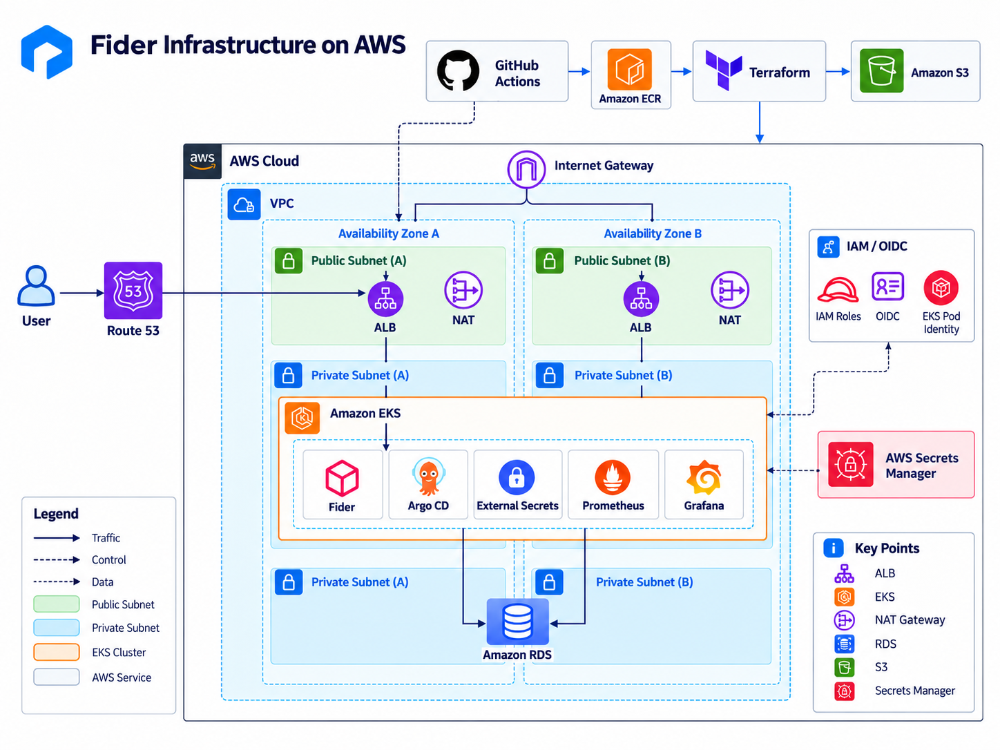
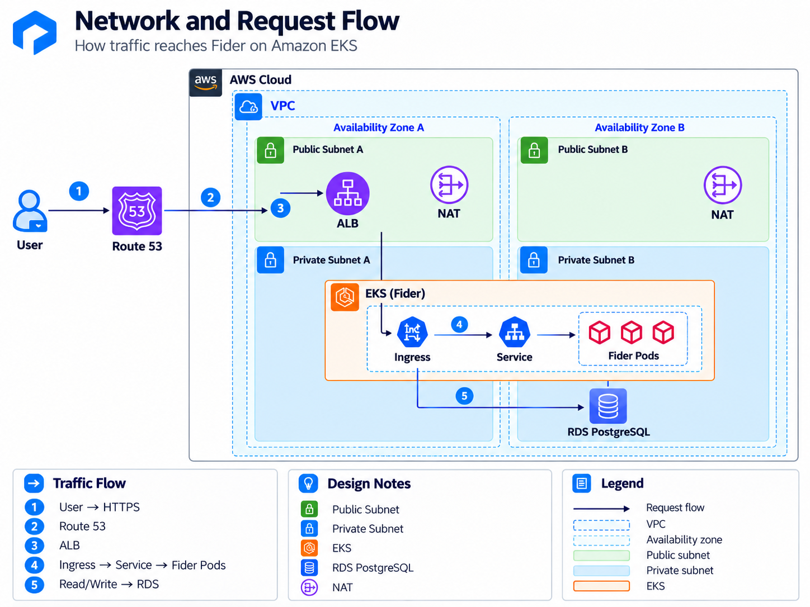
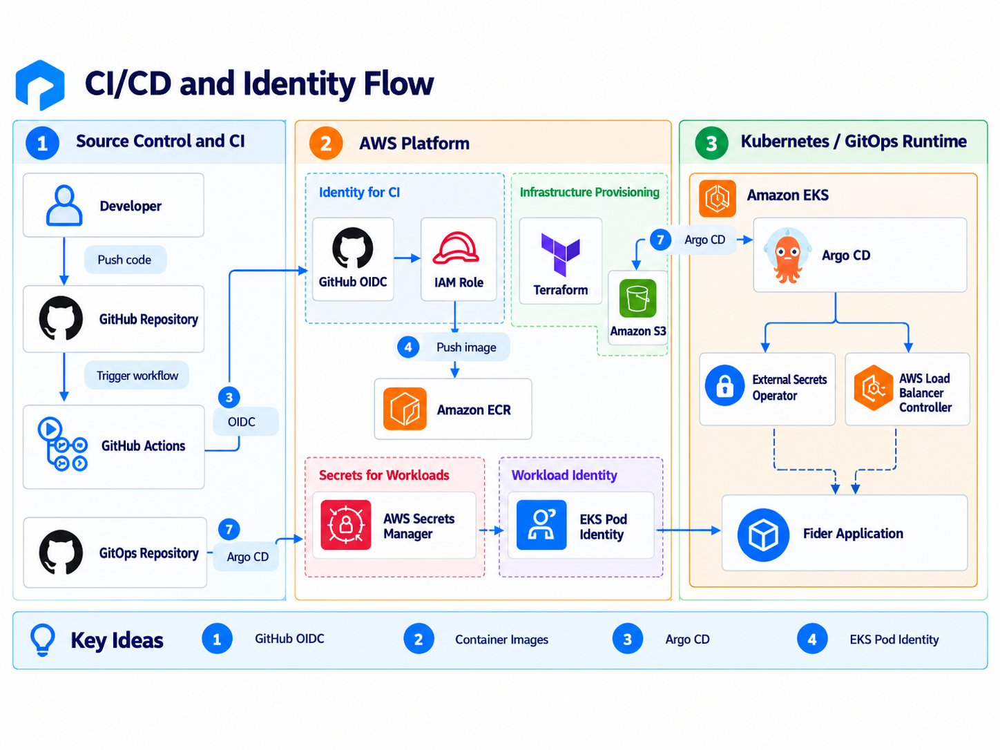

# Fider Infrastructure — AWS EKS with Terraform

Infrastructure as Code for deploying an open-source customer feedback application on **Amazon EKS**, using Terraform to provision and manage the underlying AWS infrastructure.

This project focuses on building a secure, container-based AWS environment with private networking, managed Kubernetes, PostgreSQL, IAM authentication and automated infrastructure checks.

Fider is the application used to demonstrate the infrastructure. Its container build and Kubernetes deployment are managed in separate repositories.

## Architecture Overview





*An overview of the VPC, public and private subnets, Application Load Balancer, EKS worker nodes, RDS PostgreSQL, Amazon ECR and AWS Secrets Manager.*

The infrastructure runs in AWS `us-east-1` across two Availability Zones.

| Component | Implementation |
|---|---|
| Infrastructure as Code | Terraform |
| Networking | VPC, 2 public subnets, 2 private subnets, NAT Gateway |
| Container orchestration | Amazon EKS |
| Worker nodes | 5 × `t3.small` EC2 instances |
| Load balancing | AWS Application Load Balancer |
| Database | Amazon RDS PostgreSQL |
| Container registry | Amazon ECR |
| Secrets | AWS Secrets Manager |
| Authentication | IAM, EKS Pod Identity, GitHub OIDC |
| Storage | Amazon S3 |
| Logging | Amazon CloudWatch |
| Deployment | Helm and Argo CD, managed through `fider-gitops` |

## Network Architecture





*Shows how incoming HTTPS requests reach Fider, how workloads access PostgreSQL and why the worker nodes and database are placed in private subnets.*

### Public and private subnets

The VPC contains two public and two private subnets distributed across two Availability Zones.

**Public subnets**

- Host the internet-facing Application Load Balancer.
- Route internet traffic through an Internet Gateway.
- Provide the public entry point for the application.

**Private subnets**

- Host the EKS worker nodes and application Pods.
- Contain the RDS PostgreSQL database.
- Use a NAT Gateway for outbound internet access where required.

Keeping the EKS worker nodes and database in private subnets reduces their direct exposure to the internet.

### Application request flow

1. A user accesses Fider using an HTTPS URL.
2. DNS resolves the application's hostname to the Application Load Balancer.
3. The ALB uses an ACM certificate for HTTPS.
4. The AWS Load Balancer Controller configures the ALB based on Kubernetes Ingress resources.
5. Traffic is routed to the appropriate Fider Pod in EKS.
6. Fider communicates with PostgreSQL through its private RDS endpoint.

Kubernetes handles application Pods and Services, while AWS provides the surrounding networking and managed services.

## EKS Architecture

Amazon EKS provides the Kubernetes control plane.

The cluster uses a managed node group consisting of five `t3.small` EC2 instances.

The worker nodes run application and supporting Kubernetes workloads, including Fider, Argo CD, External Secrets Operator and monitoring components.

The infrastructure also provisions IAM roles and Pod Identity associations required by Kubernetes components.

## Database and Secrets Management

Amazon RDS provides a managed PostgreSQL database deployed in private subnets.

The database configuration includes:

- Private networking and security group restrictions.
- Encrypted storage.
- Automated backups.
- AWS-managed database credentials stored in Secrets Manager.

Application credentials are not hardcoded into Terraform or committed to Git.

External Secrets Operator, installed through `fider-gitops`, uses AWS permissions to retrieve the required secrets and create Kubernetes Secrets for the application.

## IAM and Authentication


 

*Shows the relationship between GitHub Actions, AWS OIDC, Amazon ECR, Argo CD, EKS Pod Identity and Secrets Manager.*

The project uses IAM roles for different responsibilities.

### GitHub Actions and AWS OIDC

The application pipeline authenticates to AWS using OpenID Connect (OIDC).

GitHub Actions assumes an IAM role to publish Docker images to ECR without storing permanent AWS access keys in GitHub.

### EKS Pod Identity

Kubernetes workloads use dedicated IAM roles through EKS Pod Identity.

This allows supporting components, including External Secrets Operator and AWS Load Balancer Controller, to access the AWS services required for their jobs.

Permissions are separated according to each component's responsibilities.

## Terraform State Management

Terraform state is stored remotely in Amazon S3.

The project separates infrastructure into two stages:

**Bootstrap**

Creates the AWS resources required for Terraform remote state.

**Platform**

Provisions the main AWS infrastructure, including networking, EKS, RDS, IAM, ECR and supporting resources.

The two stages use separate Terraform state files, helping keep state management separate from the resources being deployed.

The S3 backend uses native state locking to reduce the risk of concurrent Terraform operations.

## Infrastructure CI

GitHub Actions runs automated infrastructure checks to identify problems before Terraform changes are applied.

| Tool | Purpose |
|---|---|
| `terraform fmt` | Checks Terraform formatting |
| `terraform validate` | Validates Terraform configuration |
| Checkov | Scans infrastructure code for security misconfigurations |
| TFLint | Provides additional Terraform linting during local development |
| Pre-commit | Runs configured local checks before commits |

Terraform changes are reviewed through the Git workflow before being applied manually.

## Repository Structure

```text
fider-infra/
├── .github/
│   └── workflows/       # Terraform CI
├── bootstrap/           # Remote state infrastructure
├── platform/            # AWS infrastructure
├── docs/
│   ├── runbook.md       # Provisioning instructions
│   └── images/          # Architecture diagrams
├── .pre-commit-config.yaml
└── README.md
```

## Deployment Instructions

See the **[Infrastructure Runbook](docs/runbook.md)** for instructions on configuring AWS credentials, initialising Terraform, creating the infrastructure and connecting to EKS.

## Related Repositories

- [fider-app](https://github.com/aactive1/fider-app) — Docker, local development, application CI/CD and Amazon ECR image publishing.
- [fider-gitops](https://github.com/aactive1/fider-gitops) — Kubernetes resources, Helm, Argo CD, External Secrets Operator and monitoring.

## Project Scope

This is a portfolio environment designed to demonstrate hands-on AWS, Terraform, Kubernetes and DevOps skills.

It follows production-style design principles, including private networking, automated infrastructure provisioning and workload identity, without claiming to be a fully production-hardened platform.
